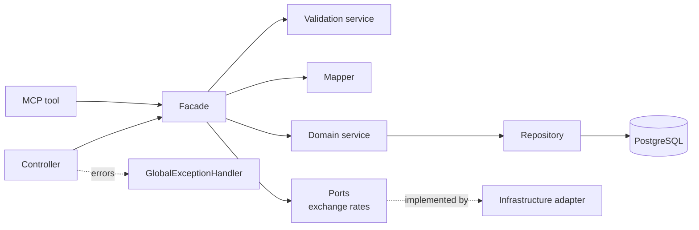
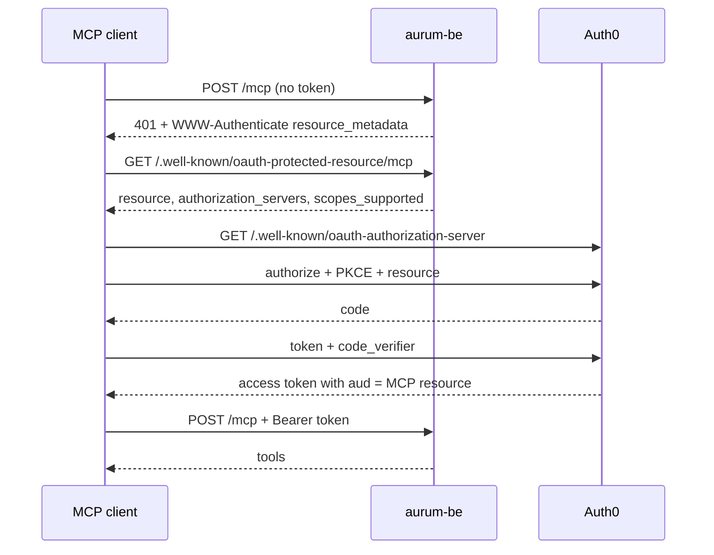
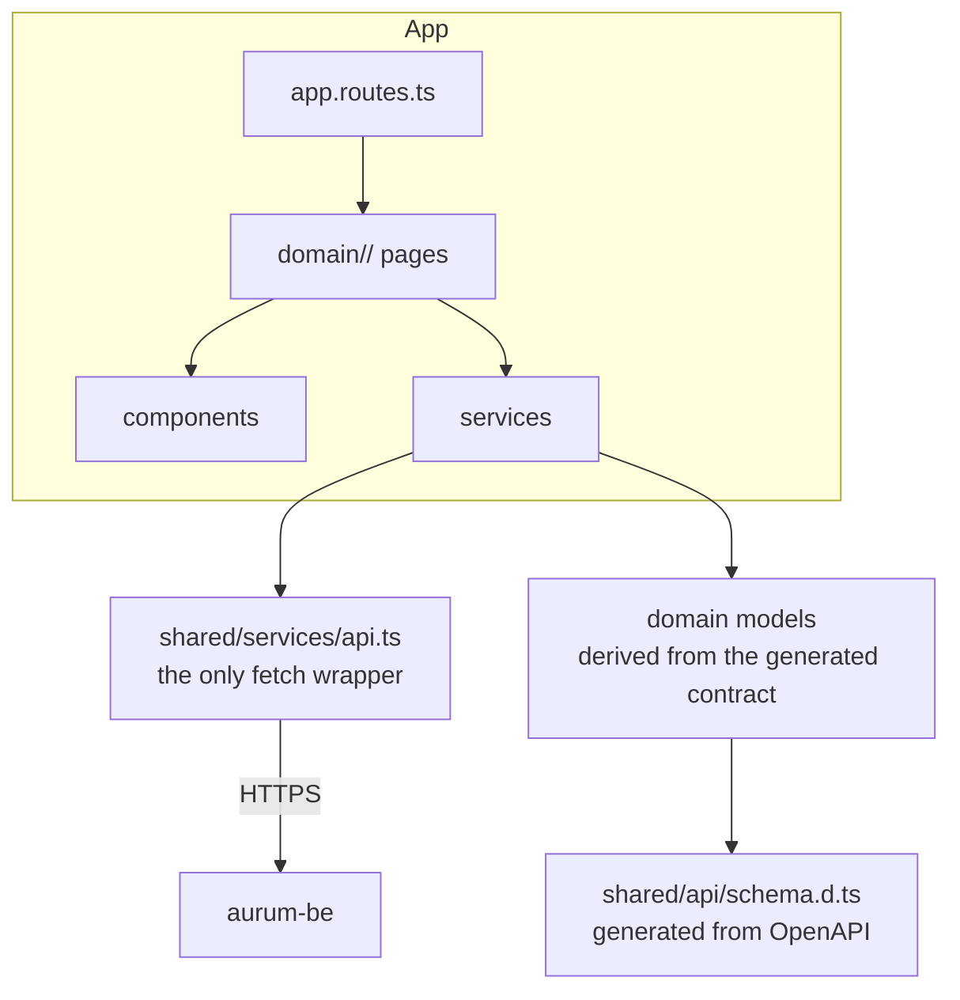

# Aurum

Personal wealth management: track assets and liabilities, record snapshots over
time, watch net worth evolve, and set financial targets. Multi-currency, with
the user's own currency and locale for every formatted number.

## Repository layout

```
aurum/
├── aurum-be/            Spring Boot 3.4 API (Java 25) + MCP tools
├── aurum-fe/            Angular 21 single-page app
├── docker-compose.prod.yml   production stack (Postgres + backend)
└── Makefile             starts both apps for local development
```

## Architecture

### Backend

Each domain under `aurum-be/src/main/java/com/backend/aurum/domain/` follows the
same chain, and every layer has exactly one job:



- **Controller** — parses the request, resolves the authenticated user, calls a
  facade, shapes the HTTP response. No business rules.
- **Facade** — the single entry point for a domain. It owns the order:
  validation → DTO/entity mapping → service call → DTO mapping. Controllers and
  MCP tools both go through it, so HTTP and MCP can never drift apart.
- **Domain service** — the business rules (what a snapshot means, when a target
  completes, how a liability is paid). It depends on repository interfaces, not
  on Spring or SQL.
- **Repository** — persistence only.
- **Ports** (`domain/shared/port/`) — what the domain needs from the outside
  world, declared in domain language. `ExchangeRateProvider` is the current one;
  `infrastructure/exchange/` implements it. Domain code never imports
  `infrastructure`.
- **Errors** (`domain/shared/exception/`) — `NotFoundException`,
  `AccessDeniedException`, `ValidationException` are domain errors. The
  `GlobalExceptionHandler` in `infrastructure` is the only place that maps them
  to HTTP status codes.

Migrations are Liquibase YAML/SQL under
`aurum-be/src/main/resources/db/changelog/changes/`, applied automatically at
startup. Schema validation is on (`ddl-auto: validate`), so an entity that
disagrees with the changelog fails fast instead of silently diverging.

### MCP authorization

The MCP endpoint is an OAuth 2.1 resource server. Auth0 is the authorization
server; the backend only publishes the resource metadata and validates the
token. There is no OAuth proxy, no client secret and no per-session state.



- `mcp.resource-url` is the canonical MCP URI and must match the Auth0 API
  identifier; `mcp.audience` defaults to it. A token minted for the web app is
  rejected at `/mcp`.
- The transport is stateless (`spring.ai.mcp.server.protocol=STATELESS`), so
  every request is authenticated independently.
- Read/write scopes are optional. When `MCP_READ_SCOPES` and `MCP_WRITE_SCOPES`
  are set, `get*` tools require the read scope and every other tool requires
  the write scope.
- `MCP_ALLOWED_ORIGINS` is the browser-origin allowlist for `/mcp`; native MCP
  clients send no `Origin` and are unaffected.
- The full tenant setup is in
  [`docs/mcp-auth0-setup.md`](docs/mcp-auth0-setup.md).

### Frontend



- One folder per domain (`asset`, `snapshot`, `target`, `dashboard`, `cashflow`,
  `profile`), each with its own `model/`, `components/`, and services.
- `shared/` holds what more than one domain needs.
- Components render; services fetch and hold state; utilities are pure.

### The API contract is generated, not duplicated

The backend is the single source of truth for every request and response shape:

1. `aurum-be/openapi.json` is exported from the running backend
   (`GET /v3/api-docs`). DTOs carry `@Schema(requiredProperties = …)` and
   `@Schema(nullable = true)`, so the document states which fields are always
   present and which can be null.
2. `npm run api:types` regenerates `aurum-fe/src/app/shared/api/schema.d.ts`
   from that document.
3. `aurum-fe/src/app/shared/api/contract.ts` re-exports the generated schemas
   under the names the app uses. Domain models derive from them and add only
   frontend concerns (a `Date` in a form, a view-only row type).

After changing a DTO: restart the backend, re-export `openapi.json`, run
`npm run api:types`, and let the compiler point at every call site that needs
attention. Never hand-edit `schema.d.ts`.

Frontend-only models are deliberate and named as such: `CashFlowRow` (table
row), `Projections` (chart), the form value types, and `UserProfile` (the
`/users` account plus the email read from the Auth0 token — the backend stores
no email).

### Data model

```
User ──1:N── AssetCategory
User ──1:N── Asset ──1:N── Snapshot
User ──1:N── Target
AssetCategory ──1:N── Asset
```

A `Snapshot` stores `amountOriginalCurrency` plus `exchangeRateToBase`;
`amountBaseCurrency` is the converted value the analytics read.

## Local development

```bash
make start    # Postgres in Docker, backend on :8080, frontend on :4200
make stop
```

The backend reads secrets from
`aurum-be/src/main/resources/application-local.properties` (gitignored, loaded
by the `local` profile). Copy
`application-local.properties.example` and fill in the Auth0 values.

Useful commands:

```bash
cd aurum-fe && npm start          # ng serve with HMR
cd aurum-fe && npm test           # Vitest
cd aurum-fe && npm run api:types  # regenerate types from openapi.json
cd aurum-be && ./mvnw test        # JUnit 5
cd aurum-be && ./mvnw clean package
```

## Deployment

| Part | Where | Trigger |
| --- | --- | --- |
| Frontend | Vercel, `aurum-networth.com` | push to `main` (Vercel integration) |
| Backend | Hetzner VPS via Docker Compose, `api.aurum-networth.com` | `deploy.yml`, push to `main` touching `aurum-be/**`, `docker-compose.prod.yml`, or the workflow itself |
| Database | PostgreSQL 17 container on the same VPS | `docker compose up -d` during the backend deploy |

The deploy workflow builds the backend image, pushes it to GHCR, copies
`docker-compose.prod.yml` to the server, and runs `docker compose pull && up -d`
over SSH. There is no staging environment: **a merge to `main` that touches the
backend is a production deploy.** Frontend routes are served by Vercel at the
root; the API is served at the root of its own subdomain, with no `/api` prefix.

## Security

- Auth0 issues the JWTs; the backend validates them as an OAuth2 resource
  server. Every endpoint requires a token except the Swagger paths and the
  protected-resource metadata documents.
- The MCP endpoint has its own audience (`mcp.audience`, defaulting to the MCP
  resource URI), so web-app tokens cannot be replayed against it. See
  [`docs/mcp-auth0-setup.md`](docs/mcp-auth0-setup.md).
- The MCP transport is stateless and rejects browser origins that are not
  explicitly allowlisted.
- Secrets never live in the repository: local values in
  `application-local.properties`, production values as environment variables on
  the VPS and in Vercel.
- gitleaks runs on staged changes (pre-commit) and in CI.
- The full audit and the open follow-ups are in
  [`docs/security-audit.md`](docs/security-audit.md).
