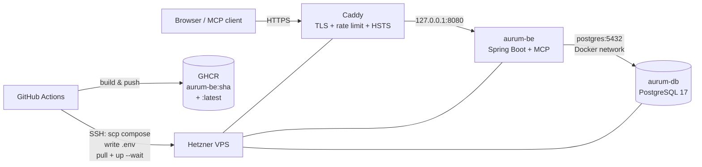

# Production operations

This document covers the deployed system. It deliberately contains no host
address, SSH user, key path or secret: the repository is public. Those details
live in a private runbook outside the repository.

## Topology



- **Frontend**: Vercel, from `main`.
- **Backend + database**: a Hetzner VPS running Docker Compose.
- **TLS and public entry point**: Caddy on the host, automatic certificates,
  rate limit, HSTS, and SSE-friendly proxying for `/mcp`.
- **Image**: `ghcr.io/<owner>/aurum-be`, pushed with two tags — `:latest` and
  `:<commit sha>` — by `.github/workflows/deploy.yml`. The host runs the SHA
  tag; `latest` is what a human pulls by hand.
- **Secrets**: `/opt/aurum/.env` on the server, mode `600`. The MCP keys are
  injected from GitHub Actions **repository variables** at deploy time.

## Deploy

A push to `main` that touches `aurum-be/**`, `docker-compose.prod.yml` or the
deploy workflow triggers the deploy. Manual run, from `main` only:

```bash
gh workflow run deploy.yml --ref main
```

Guards on the workflow:

- **Main only.** A `guard` job fails on any ref other than `refs/heads/main`,
  and the deploy job carries `if: github.ref == 'refs/heads/main'`. A
  `workflow_dispatch` aimed at a branch ends red, before anything is built.
- **Serialised.** Workflow-level `concurrency: deploy-production` with
  `cancel-in-progress: false`: a second deploy queues behind the running one and
  never cancels an `up` halfway.
- **Host key not verified.** Both SSH steps accept whatever host key port 22
  presents: `known_hosts` is empty on the runner and no `fingerprint:` pin is
  set, so a host with a changed key is not refused. This is tracked in
  [#133](https://github.com/Mxo01/Aurum/issues/133) and is a known open gap, not
  a guarantee. A `SHA256:` pin derived with `ssh-keyscan` — from the RSA,
  ECDSA or ED25519 key alike — could not be made to work from the GitHub
  runner: the action failed with `host key fingerprint mismatch` on pins that
  a probe workflow read from the very same host. Verification needs an
  out-of-band source of truth (the Hetzner console, or a provider-published
  `known_hosts`), not a key fetched over the connection it is meant to
  authenticate.

The workflow builds the image, pushes `:latest` and `:<sha>`, copies
`docker-compose.prod.yml` to `/opt/aurum`, writes `GHCR_IMAGE` (the SHA tag) and
the MCP variables into `/opt/aurum/.env`, sets `.env` to `600`, then runs:

```bash
docker compose -f docker-compose.prod.yml pull backend
docker compose -f docker-compose.prod.yml up -d --remove-orphans --wait --wait-timeout 180
curl -fsS --retry 12 --retry-delay 5 --retry-connrefused --max-time 10 http://127.0.0.1:8080/actuator/health
docker image prune -f --filter "until=336h"
```

`--wait` blocks until the backend healthcheck reports healthy and fails the
deploy after 180s if it does not; the explicit health request afterwards makes
the job red instead of green when the app does not answer. The prune removes
**dangling** layers older than two weeks only — the previous deploy's SHA tag is
the rollback target and survives.

It refuses to deploy if `MCP_RESOURCE_URL` is missing or is not an
`https://…/mcp` URL.

## Logs, restart and health

```bash
# backend logs
docker logs -f aurum-be

# compose view
docker compose -f /opt/aurum/docker-compose.prod.yml ps

# restart only the app
docker compose -f /opt/aurum/docker-compose.prod.yml up -d --force-recreate backend

# Caddy
journalctl -u caddy -f

# public health
curl -fsS https://api.aurum-networth.com/actuator/health
```

The container healthcheck calls `/actuator/health` with `curl`; the endpoint is
public and returns `{"status":"UP"}`. It is intentionally status-only
(`show-details=when-authorized`).

## Environment

`/opt/aurum/.env` is the single source of production configuration. It is not
in the repository and must stay `600`. Keys:

```
GHCR_IMAGE
POSTGRES_DB, POSTGRES_USER, POSTGRES_PASSWORD
AUTH0_ISSUER_URI, AUTH0_AUDIENCE
AUTH0_MANAGEMENT_DOMAIN, AUTH0_MANAGEMENT_CLIENT_ID, AUTH0_MANAGEMENT_CLIENT_SECRET
CORS_ALLOWED_ORIGINS
MCP_RESOURCE_URL, MCP_AUDIENCE, MCP_READ_SCOPES, MCP_WRITE_SCOPES, MCP_ALLOWED_ORIGINS
```

The `MCP_*` values are managed as GitHub Actions repository variables and
rewritten on every deploy. `GHCR_IMAGE` is written by the deploy too: it holds
the full `ghcr.io/<owner>/aurum-be:<sha>` reference of the running deploy.
Everything else is edited on the server.

After rotating an Auth0 secret, update this file and recreate the backend:

```bash
docker compose -f /opt/aurum/docker-compose.prod.yml up -d --force-recreate backend
```

## Schema migrations

Liquibase runs at startup: `spring.liquibase.change-log` points at
`classpath:db/changelog/db.changelog-master.yaml`. Since Boot 4 the
autoconfiguration lives in its own module, so `spring-boot-liquibase` is a
declared dependency; without it no changeset runs and `spring.liquibase.*` stays
inert.

Applied changesets are recorded in `databasechangelog`. A database that is up
to date holds one row per changeset — 31 at the time of writing — and needs
nothing: Liquibase applies only the changesets it has not recorded yet. The
count is a checkpoint to compare against, never a constant to assume.

### One-time baseline for a database that predates the module

A database built by other means has no `databasechangelog` table, so Liquibase
would replay every changeset from the first one and fail on objects that already
exist. Mark what is already in place as applied, once:

```bash
cd aurum-be
./mvnw org.liquibase:liquibase-maven-plugin:5.0.4:changelogSync \
  -Dliquibase.changeLogFile=db/changelog/db.changelog-master.yaml \
  -Dliquibase.searchPath=src/main/resources \
  -Dliquibase.url="$DATASOURCE_URL" \
  -Dliquibase.username="$DATASOURCE_USERNAME" \
  -Dliquibase.password="$DATASOURCE_PASSWORD"
```

- Run it from the checkout whose changelog matches the schema the database
  already has (the last deployed `main`). A changeset added after that point
  must still run for real, so never `changelogSync` a changelog over a database
  that is behind it.
- `$DATASOURCE_*` are shell variables in the operator's own environment; never
  paste the real URL or credentials into the repository.
- The plugin is not declared in `pom.xml`: the coordinate carries the version
  (5.0.4, the one the Boot BOM manages), and the JDBC driver comes from the
  project's own dependencies, which the plugin puts on its classpath.
- `changelogSyncSQL` prints the same decision without writing to the database,
  which makes a safe dry run.

### Pointing a boot away from the developer's database

`spring-boot-docker-compose` is a declared dependency, so a local
`./mvnw spring-boot:run` starts the Compose services and wires the datasource to
`aurum-be/compose.yaml` (service `postgres`, `POSTGRES_DB=aurum`). That bean
outranks `spring.datasource.url`, so on that path a command-line datasource
override is silently ignored and the boot still lands on the developer's
database. Any `spring-boot:run` that must not touch it — a changelog replay, a
migration probe, a destructive experiment — needs both of the following flags:

```bash
--spring.docker.compose.enabled=false
--spring.datasource.url=<throwaway-database-url>
```

The module is excluded from the repackaged jar by the Spring Boot plugin, so a
deployed artifact has none of this: `java -jar` takes `spring.datasource.url`
as given. Only `spring-boot:run` — which resolves the full classpath — sees the
autoconfiguration. The CI jar check below keeps it that way.

### What the jar contains

The production image runs a Spring Boot fat jar built by `./mvnw -DskipTests
package`. Two things must never be inside it:

- `application-local.properties` — the local secrets file. Its old home is
  `aurum-be/src/main/resources/`, which the build excludes from the jar; the
  supported location is `aurum-be/config/`, gitignored and never packaged. Copy
  `application-local.properties.example` to `config/application-local.properties`
  for local work — `spring-boot:run` reads `./config/` from the module root, and
  `make start` is unaffected.
- the `spring-boot-docker-compose` module (see above).

`ci.yml` fails the pull request when either shows up in `unzip -l` of the built
jar, which is the check that keeps a local secrets file from reaching an image.

### Swagger outside development

`/swagger-ui.html` and `/v3/api-docs` are off by default and gated by a flag:

```bash
SWAGGER_ENABLED=true ./mvnw spring-boot:run   # local only
```

Production does not set it, so the docs endpoint 404s and Swagger paths are not
part of the public surface. The flag is read at startup: changing it needs a
restart, and there is no reason to set it on the server.

## Database backup and restore

A daily `pg_dump` runs at 03:15 via `/etc/cron.d/aurum-backup`, writes to
`/root/backups/aurum-YYYY-MM-DD.sql.gz`, and keeps seven days:

```bash
ls -lh /root/backups
```

Restore into a **fresh** database (do not pipe into the live one):

```bash
gunzip -c /root/backups/aurum-2026-11-13.sql.gz \
  | docker exec -i aurum-db psql -U "$POSTGRES_USER" -d "$POSTGRES_DB"
```

The backup lives on the same VPS, so it protects against an accidental
`DELETE`, not against losing the server. Copy it offsite (Hetzner Storage Box
or S3) on a schedule and test a restore periodically.

## TLS and Caddy

Caddy is installed on the host, not in Compose. The live config is
`/etc/caddy/Caddyfile`; keep a copy in the private runbook. It terminates TLS
for `api.aurum-networth.com`, applies a per-IP rate limit and HSTS, and proxies
to `127.0.0.1:8080` with `flush_interval -1` for MCP streaming.

```bash
caddy validate --config /etc/caddy/Caddyfile
systemctl reload caddy
```

## Rollback

Every deploy keeps the image it pushed, tagged with the commit SHA, and
`/opt/aurum/.env` records which one is running:

```bash
grep '^GHCR_IMAGE=' /opt/aurum/.env
```

Rolling back is re-pointing `GHCR_IMAGE` at a previous SHA and recreating the
backend — no rebuild, no revert:

```bash
cd /opt/aurum
sed -i 's|^GHCR_IMAGE=.*|GHCR_IMAGE=ghcr.io/<owner>/aurum-be:<previous-sha>|' .env
docker compose -f docker-compose.prod.yml pull backend
docker compose -f docker-compose.prod.yml up -d --remove-orphans --wait --wait-timeout 180
curl -fsS http://127.0.0.1:8080/actuator/health
```

The image must still be in GHCR: the deploy prunes dangling layers older than
14 days, never a tagged image, so the previous SHA normally survives several
deploys. If it is gone, fall back to rebuilding: `git revert` the bad merge on
`main` and let the push redeploy.

A rollback of a schema change is a separate decision: Liquibase changesets are
forward-only, so pick a build whose migrations match the database you have.

## Security invariants

- `8080` is bound to `127.0.0.1`, not `0.0.0.0`; only Caddy is public.
- `5432` is not published by Compose.
- `/opt/aurum/.env` is `600`.
- Caddy serves HTTPS and HSTS; the API requires a bearer token except for the
  protected-resource metadata and `/actuator/health`. Swagger is off in
  production (`SWAGGER_ENABLED` unset), so `/v3/api-docs` and the UI 404.
- SSH access is key-based. Keep it that way and keep the host firewall
  restricted to 22/80/443.
- Never commit the host address, SSH user, keys or `.env` values to this
  repository.

## Maintenance

`unattended-upgrades` is enabled. Kernel/package updates still need a reboot
window; check with:

```bash
apt-get -s upgrade
cat /var/run/reboot-required 2>/dev/null || true
```

Do not run a full upgrade during a deploy. Reboot, then verify health, PRM and
`/mcp` after the server comes back.
