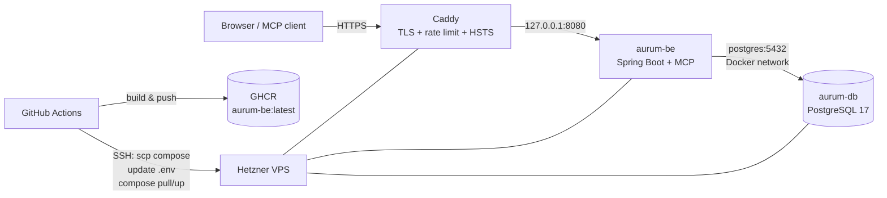

# Production operations

This document covers the deployed system. It deliberately contains no host
address, SSH user, key path or secret: the repository is public. Those details
live in a private runbook outside the repository.

## Topology



- **Frontend**: Vercel, from `main`.
- **Backend + database**: a Hetzner VPS running Docker Compose.
- **TLS and public entry point**: Caddy on the host, automatic certificates,
  rate limit, HSTS, and SSE-friendly proxying for `/mcp`.
- **Image**: `ghcr.io/<owner>/aurum-be:latest`, built and pushed by
  `.github/workflows/deploy.yml`.
- **Secrets**: `/opt/aurum/.env` on the server, mode `600`. The MCP keys are
  injected from GitHub Actions **repository variables** at deploy time.

## Deploy

A push to `main` that touches `aurum-be/**`, `docker-compose.prod.yml` or the
deploy workflow triggers the deploy. Manual run:

```bash
gh workflow run deploy.yml
```

The workflow builds the image, pushes it to GHCR, copies
`docker-compose.prod.yml` to `/opt/aurum`, rewrites the MCP variables in
`/opt/aurum/.env`, sets `.env` to `600`, then runs:

```bash
docker compose -f docker-compose.prod.yml pull backend
docker compose -f docker-compose.prod.yml up -d --remove-orphans
docker image prune -f
```

It refuses to deploy if `MCP_RESOURCE_URL` is missing or is not an
`https://…/mcp` URL.

## Logs, restart and health

```bash
# backend logs
docker logs -f aurum-be

# compose view
docker compose -f /opt/aurum/docker-compose.prod.yml ps

# restart only the app
docker compose -f /opt/aurum/docker-compose.prod.yml up -d --force-recreate backend

# Caddy
journalctl -u caddy -f

# public health
curl -fsS https://api.aurum-networth.com/actuator/health
```

The container healthcheck calls `/actuator/health` with `curl`; the endpoint is
public and returns `{"status":"UP"}`. It is intentionally status-only
(`show-details=when-authorized`).

## Environment

`/opt/aurum/.env` is the single source of production configuration. It is not
in the repository and must stay `600`. Keys:

```
GHCR_IMAGE
POSTGRES_DB, POSTGRES_USER, POSTGRES_PASSWORD
AUTH0_ISSUER_URI, AUTH0_AUDIENCE
AUTH0_MANAGEMENT_DOMAIN, AUTH0_MANAGEMENT_CLIENT_ID, AUTH0_MANAGEMENT_CLIENT_SECRET
CORS_ALLOWED_ORIGINS
MCP_RESOURCE_URL, MCP_AUDIENCE, MCP_READ_SCOPES, MCP_WRITE_SCOPES, MCP_ALLOWED_ORIGINS
```

The `MCP_*` values are managed as GitHub Actions repository variables and
rewritten on every deploy. The rest is edited on the server.

After rotating an Auth0 secret, update this file and recreate the backend:

```bash
docker compose -f /opt/aurum/docker-compose.prod.yml up -d --force-recreate backend
```

## Database backup and restore

A daily `pg_dump` runs at 03:15 via `/etc/cron.d/aurum-backup`, writes to
`/root/backups/aurum-YYYY-MM-DD.sql.gz`, and keeps seven days:

```bash
ls -lh /root/backups
```

Restore into a **fresh** database (do not pipe into the live one):

```bash
gunzip -c /root/backups/aurum-2026-11-13.sql.gz \
  | docker exec -i aurum-db psql -U "$POSTGRES_USER" -d "$POSTGRES_DB"
```

The backup lives on the same VPS, so it protects against an accidental
`DELETE`, not against losing the server. Copy it offsite (Hetzner Storage Box
or S3) on a schedule and test a restore periodically.

## TLS and Caddy

Caddy is installed on the host, not in Compose. The live config is
`/etc/caddy/Caddyfile`; keep a copy in the private runbook. It terminates TLS
for `api.aurum-networth.com`, applies a per-IP rate limit and HSTS, and proxies
to `127.0.0.1:8080` with `flush_interval -1` for MCP streaming.

```bash
caddy validate --config /etc/caddy/Caddyfile
systemctl reload caddy
```

## Rollback

Images are currently tagged only `latest`, so a rollback means rebuilding and
redeploying the previous commit:

```bash
git switch main
git revert <bad-merge-commit>
git push
```

Tagging images with the commit SHA (`aurum-be:<sha>`) and keeping the previous
tag is a follow-up; it would make rollback a one-line compose change.

## Security invariants

- `8080` is bound to `127.0.0.1`, not `0.0.0.0`; only Caddy is public.
- `5432` is not published by Compose.
- `/opt/aurum/.env` is `600`.
- Caddy serves HTTPS and HSTS; the API requires a bearer token except for the
  Swagger paths, the protected-resource metadata and `/actuator/health`.
- SSH access is key-based. Keep it that way and keep the host firewall
  restricted to 22/80/443.
- Never commit the host address, SSH user, keys or `.env` values to this
  repository.

## Maintenance

`unattended-upgrades` is enabled. Kernel/package updates still need a reboot
window; check with:

```bash
apt-get -s upgrade
cat /var/run/reboot-required 2>/dev/null || true
```

Do not run a full upgrade during a deploy. Reboot, then verify health, PRM and
`/mcp` after the server comes back.
